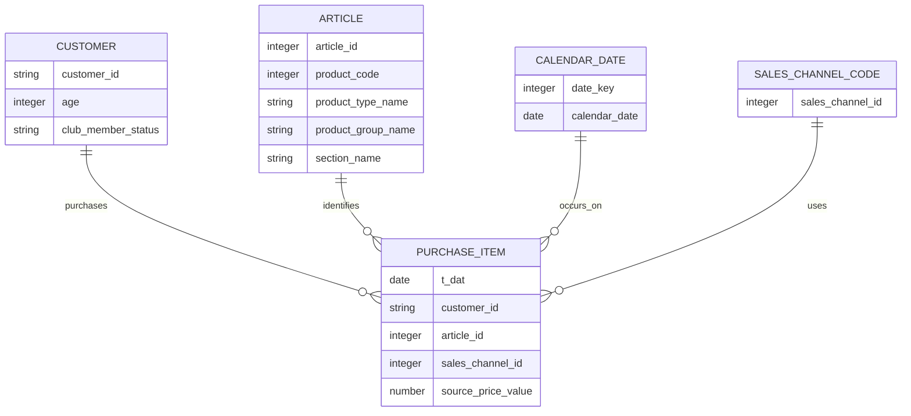

# 概念设计

- 状态：概念模型方案已形成；与用户确认的 W04 首版主题排序一致
- 最后更新：2026-11-12（Asia/Shanghai）
- 文档职责：描述业务过程、业务对象及其关系；字段到表的映射见逻辑设计

## 1. 业务过程

首要业务过程为客户购买商品：在某个自然日，某客户通过一个来源渠道购买某个商品款式，并产生源价格数值。数据粒度是商品购买记录，没有订单 ID，因此同日多行不等同于订单，也不能分析购物篮。

基于该过程可延伸出三类商业分析：商品与品类购买表现、客户跨日期再次购买行为、渠道编码与时间变化。商品和客户描述属性用于分组购买记录；这不是完整的零售运营事实，因为没有库存、曝光、退货、促销或利润过程。

## 2. 核心业务对象

| 对象 | 含义 | 关键属性 | 关系与边界 |
| --- | --- | --- | --- |
| 商品购买记录 | 一条源交易行，表示一件商品购买 | 日期、客户、商品、渠道编码、源价格数值 | 多条记录可以在所有字段相同时出现；必须分别保留 |
| 客户 | 竞赛数据中的客户伪名键及当前属性快照 | 客户键、年龄、会员状态、资讯频率、源标记 | 一个客户可关联多条购买记录；属性无历史有效期 |
| 商品款式 | `article_id` 对应的目录条目 | 款式键、商品类型、商品组、颜色、部门、版块、描述 | 一个商品目录条目可关联多条购买记录；没有库存或上架历史 |
| 自然日期 | 购买发生的日历日期 | 年、季度、月、星期 | 一个自然日可关联多条购买记录；不附加未核实地域节假日 |
| 销售渠道编码 | 源文件中的整数编码 | `sales_channel_id` | 一个编码可关联多条购买记录；编码 1、2 的业务名称待核实 |
| 商品分类属性 | 商品行上的多个源分类字段 | 商品组、商品类型、`index`、`section`、服装组等 | 先作为并列描述属性；未经业务定义核实，不预设严格父子层级 |

## 3. 概念关系

图中关系表达购买记录的关联，不表示有订单实体或真实渠道名称。商品分类字段来自商品属性对象，不另造未经验证的商品层级实体。

## 4. 由业务问题推导的分析主题

1. **商品组合与表现**：观察购买件数、买家覆盖、分类构成和完整月份变化，支持识别值得复核的商品与品类。
2. **客户再次购买行为**：按不同购买日期统计客户频次与首个观察日后的 30／60／90 日再次购买日比例，形成留存研究线索；不等于真实拉新或营销留存。
3. **渠道编码差异**：比较源渠道编码的购买构成及商品组合，业务标签核实后再命名。
4. **时间变化**：比较购买件数和活跃购买客户数的月度变化。两年样本只能作描述性观察，且首尾月份是部分月份。

指标定义统一维护在 [需求分析](02-需求分析.md)，实体到事实和维度的映射见 [逻辑设计](05-逻辑设计.md)。

## 5. 概念限制

- 客户属性与商品目录均没有有效日期，分析历史购买时连接的是竞赛提供的静态属性快照。
- 同一客户同一天的商品记录没有订单归属信息，不形成篮子、订单或购买会话对象。
- 源 `price` 没有货币定义；不建立概念上的“销售收入”事实。
- 现有表不包含访问、库存、退货、促销和成本业务过程，不能据此描述转化、售罄、退货、利润或活动增量。
- 数据按 Kaggle 规则仅用于非商业教育和研究；商业经营问题是课程分析设计视角，不改变数据使用限制。
