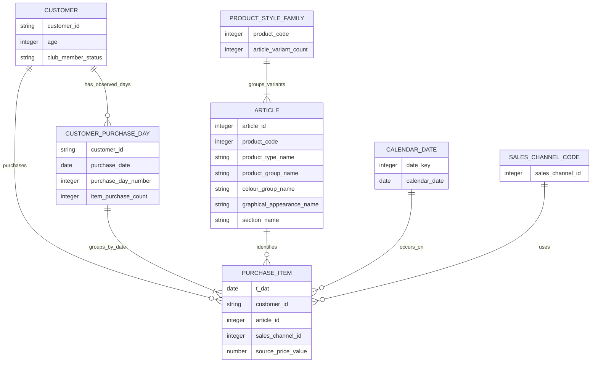

# 概念设计

- 状态：扩展版概念模型已形成；包含款式族候选、商品变体和客户购买日序列
- 最后更新：2026-11-12（Asia/Shanghai）
- 文档职责：描述业务过程、业务对象及其关系；字段到表的映射见逻辑设计

## 1. 业务过程

首要业务过程为客户购买商品：在某个自然日，某客户通过一个来源渠道购买某个商品款式，并产生源价格数值。数据粒度是商品购买记录，没有订单 ID，因此同日多行不等同于订单，也不能分析购物篮。

基于该过程可扩展为商品组合、颜色与图案变体表现、客户按购买日排序的回购阶段、渠道编码组合、相邻购买日的品类变化和时间趋势。商品和客户描述属性用于分组购买记录；这不是完整的零售运营事实，因为没有库存、曝光、订单、退货、促销或利润过程。

## 2. 核心业务对象

| 对象 | 含义 | 关键属性 | 关系与边界 |
| --- | --- | --- | --- |
| 商品购买记录 | 一条源交易行，表示一件商品购买 | 日期、客户、商品、渠道编码、源价格数值 | 多条记录可以在所有字段相同时出现；必须分别保留 |
| 客户 | 竞赛数据中的客户伪名键及当前属性快照 | 客户键、年龄、会员状态、资讯频率、源标记 | 一个客户可关联多条购买记录；属性无历史有效期 |
| 款式族候选 | `product_code` 编码对应的一组目录款式候选 | 候选款式族键、族内 `article_id` 数、颜色与图案变体 | 本地观察发现 47,224 个候选码、23,158 组含多个 `article_id`；314 组有多个类型、96 组有多个商品组；需保留分类不一致并下钻 |
| 商品款式变体 | `article_id` 对应的目录条目 | 变体键、商品类型、商品组、颜色组、主色系、明暗值、图案、部门、版块、描述 | 一个目录条目可关联多条购买记录；没有库存、曝光或上架历史 |
| 自然日期 | 购买发生的日历日期 | 年、季度、月、星期 | 一个自然日可关联多条购买记录；不附加未核实地域节假日 |
| 销售渠道编码 | 源文件中的整数编码 | `sales_channel_id` | 一个编码可关联多条购买记录；编码 1、2 的业务名称待核实 |
| 商品分类属性 | 商品行上的多个源分类字段 | 商品组、商品类型、`index`、`section`、服装组等 | 先作为并列描述属性；未经业务定义核实，不预设严格父子层级 |
| 客户购买日序列（派生） | 每客户每个有购买记录的不同自然日一行 | 客户键、购买日期、客户第 N 个观察购买日序号、当日购买件数、前后购买日间隔 | 从购买明细按客户和日期派生；同日多商品合并到一个购买日，不生成订单实体 |

## 3. 概念关系

图中 `PRODUCT_STYLE_FAMILY` 是对 `product_code` 的候选款式族概念，用于族级表现和族内变体比较，不等于竞赛方已确认的业务定义。`CUSTOMER_PURCHASE_DAY` 是分析派生对象，不表示订单、门店访问或会话。图中渠道仍是代码值，不表示真实渠道名称。

## 4. 由业务问题推导的分析主题

1. **商品组合、款式族与变体**：按商品组、类型、服装组、部门、版块和 `product_code` 候选款式族观察购买件数、买家覆盖、集中度和月份变化。
2. **颜色、明暗与图案**：比较颜色组、主色系、感知颜色值和图案在品类、款式族、客群、渠道编码和月份中的购买构成。
3. **客户回购阶段**：对每客户不同购买日期排序，比较第 1、2、3 个观察购买日后的 30／60／90 日再次购买日率；回购少只能说明该观察窗口内未看到下一次购买，不能说放弃品牌。
4. **客户近期性与长间隔回购**：衡量距 2020-09-22 最后购买的天数、相邻购买日期间隔以及 90 天以上间隔后再次购买的现象；全部仅限历史样本。
5. **渠道构成与切换**：比较代码 1、2 的商品与客户构成，以及相邻客户购买日之间是否由一个代码切换到另一个代码；线上／线下名称查明后再展示。
6. **跨购买日品类变化**：比较客户前后两个不同购买日的类别组合；不是同一订单里的连带或购物篮分析。
7. **日期与源价格分布**：按月份、季度、星期观察购买变化；源价格数值只作分布比较。

指标定义统一维护在 [需求分析](02-需求分析.md)，实体到事实和维度的映射见 [逻辑设计](05-逻辑设计.md)。

## 5. 概念限制

- 客户属性与商品目录均没有有效日期，分析历史购买时连接的是竞赛提供的静态属性快照。
- 同一客户同一天的商品记录没有订单归属信息，不形成篮子、订单或购买会话对象。
- 首个观察购买日之前的历史未知，数据截止日之后无购买结果；`product_code` 分组也是从编码关系观察到的候选业务对象，不是已核实的生命周期或款式族定义。
- `sales_channel_id` 尚无权威名称映射；线上／线下分析要等来源定义确认后再命名。
- 源 `price` 没有货币定义；不建立概念上的“销售收入”事实。
- 现有表不包含访问、库存、退货、促销和成本业务过程，不能据此描述转化、售罄、退货、利润或活动增量。
- 数据按 Kaggle 规则仅用于非商业教育和研究；商业经营问题是课程分析设计视角，不改变数据使用限制。
