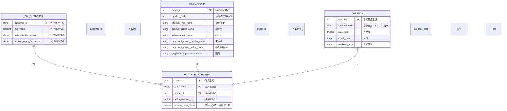
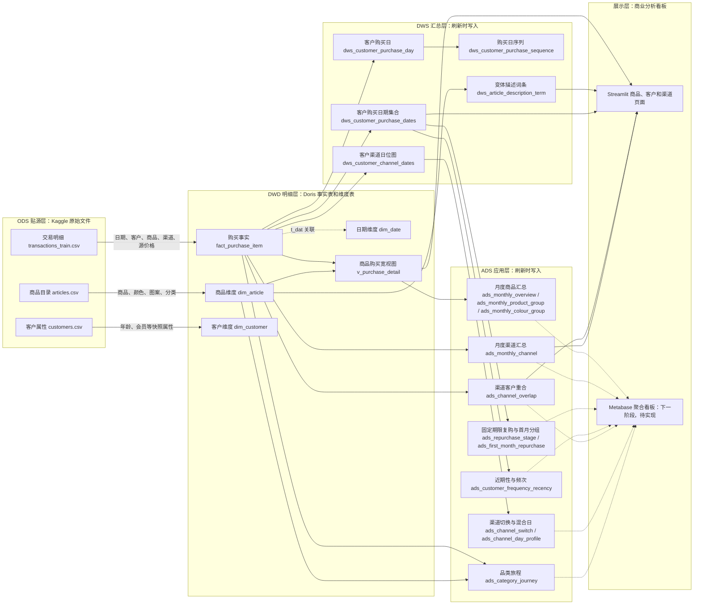

# 逻辑设计

- 状态：逻辑模型已扩展；DWS 与 ADS 已落成可刷新的汇总表，明细星型仍在 DWD
- 最后更新：2026-11-17（Asia/Shanghai）
- 文档职责：定义分析粒度、事实和维度、键关系、历史处理与分析层

## 1. 建模目标与范围

逻辑模型围绕 [W04 需求和指标](02-需求分析.md) 中的商品层级、款式族候选、颜色／图案变体、客户按不同购买日的回购阶段、渠道构成和时间变化分析。原始 CSV 保持只读并用于重载；Doris 首版维护购买明细事实和描述维度，不在数据库内再长期复制一份 3.2 GB 级原始交易文件。

## 2. 事实表

### `fact_purchase_item`

- **粒度**：源 `transactions_train.csv` 每一行一条商品购买记录；每行按一件商品购买计。
- **度量**：记录数（即观察购买件数）；可对源 `price` 作均值和中位数描述，但不能求和为营收。
- **维度键**：`t_dat`、`customer_id`、`article_id`、`sales_channel_id`。
- **自然唯一键**：没有。来源不存在交易 ID；若多行所有字段相同仍需保留。
- **事实属性**：源 `price` 数值。
- **预计记录数**：31,788,324 行，具体装载验收时重新核对。

### `fact_customer_purchase_day`（派生分析事实，不是源事实表）

从购买明细按 `customer_id + t_dat` 临时聚合，一位客户一个购买日一行。建议派生字段为：`purchase_day_number`（该客户第几个不同购买日）、当日购买件数、当日不同 `article_id` 数、当日渠道编码种类数、单一渠道编码（若适用）、前一个购买日、下一个购买日和相邻日间隔。用于第 N 个购买日后的 30／60／90 日再次购买率、首现月份组切片、购买间隔和跨渠道编码切换。它表示不同日期的购买事件，不是假设订单、到店或会话。物理表是 `dws_customer_purchase_day` 和带购买日序号的 `dws_customer_purchase_sequence`。`analytics-install` 从购买事实重算并覆盖写入，看板读取结果，不在每次打开页面时重算。

## 3. 维度模型

| 逻辑维度 | 主键／关联键 | 内容 | 历史策略 |
| --- | --- | --- | --- |
| `dim_customer` | `customer_id` | 年龄、会员状态和资讯频率；`FN` 不进入分析；邮编哈希不进入首版分析维度 | 单一静态快照；不做缓慢变化维处理，不把当前值解释为交易时点值 |
| `dim_article` | `article_id` | 具体变体及商品分类、颜色、明暗、图案等属性；`product_code` 用作款式族候选汇总键 | 单一静态目录快照；无生效区间、库存或上下架历史；款式族内分类冲突需保留 |
| `dim_date` | `date_key`，另保留 `calendar_date` | 年、季度、月、星期及 ISO 周年／周序号等通用日历字段 | 由源日期最小值至最大值生成，不加入未知地区节假日 |
| 渠道编码 | `sales_channel_id` | 交易事实中的源编码 | 保留源编码；项目口径规定 1=线下、2=线上 |

商品分类字段先作为商品维度中的独立属性，不将 `index_group`、`index`、`section` 等未经来源定义确认的字段预设为严格层级。

`product_code` 暂不额外生成实体表：质量盘点发现同一编码下可有多个 `article_id`、颜色和图案变体，但也有少数编码跨多个类型／商品组。首版以 `dim_article.product_code` 分组并支持下钻，发现分类冲突时分别展示；若后续业务定义确认款式族规则，再决定是否拆分独立款式族维度。

商品描述词条先写入 `dws_article_description_term`，每个 `article_id + 词条` 一行。排行查询再按筛选汇总购买件数并关联该表，保留零购买词条，按购买件数和字母顺序生成排名。`v_article_description_term` 只读取这张表。计算口径见 [W04 词条排行](02-需求分析.md#9-商品描述词条购买件数排行)。

## 4. 逻辑实体关系图

下图是逻辑关联，不代表 Doris 已建立外键约束。渠道编码直接保存在购买事实中，未建渠道维度；项目统一规定 1=线下、2=线上，底层保留源编码。款式族候选由 `dim_article.product_code` 分组得到。

购买事实粒度为源交易每一行；完全相同的行仍是不同购买件数。`t_dat` 通过 `dim_date.calendar_date` 关联日期维度；`sales_channel_id` 是源编码，项目口径为 1=线下、2=线上。客户购买日序列已落成 DWS 表，不加入上面这张星型关系图。

## 5. 数据层与关联规则

| 层次 | 逻辑对象 | 规则 |
| --- | --- | --- |
| ODS 贴源层 | `data/raw/hm_recommendations/*.csv` 与文件清单 | 本地只读保留，记录字节数和 SHA-256；不提交 Git，也不在 Doris 再存一份原文件 |
| DWD 明细层 | `fact_purchase_item`、`dim_customer`、`dim_article`、`dim_date`；宽视图 `v_purchase_detail` | 使用源业务键；客户和商品维度进入分析前必须通过唯一性检查；交易外键必须全部匹配。宽视图只连接事实和商品目录，供带筛选的商品查询使用，不另存 3,178 万行宽表 |
| DWS 汇总层 | `dws_customer_purchase_day`、`dws_customer_purchase_sequence`、`dws_customer_purchase_dates`、`dws_customer_channel_dates`、`dws_article_description_term` | 公共粒度：客户购买日、客户购买日期集合、客户渠道日位图、变体描述词条。由 `analytics-install` 从 DWD 覆盖写入 |
| ADS 应用层 | `ads_repurchase_stage`、`ads_first_month_repurchase`、`ads_customer_frequency_recency`、`ads_channel_overlap`、`ads_channel_switch`、`ads_channel_day_profile`、`ads_category_journey`、`ads_monthly_overview`、`ads_monthly_product_group`、`ads_monthly_colour_group`、`ads_monthly_channel` | 固定口径的回购、渠道、品类旅程和月度结果。同一命令从 DWS 或 DWD 覆盖写入。看板和后续 Metabase 通过同名 `v_` 视图读取，视图不再重算 |

日期、渠道或商品类型由页面临时指定的商品分析，仍查询 `v_purchase_detail`。这些筛选组合不是一张固定结果表。全期渠道重合、月度渠道，以及复购所读的客户购买日期集合，来自已经写好的 ADS 或 DWS 表。

客户与商品维度分别按其主键一对多连接购买事实；日期按交易日关联日历；渠道使用源编码分组。维度连接前须验证键唯一，以避免一条购买行被维度重复匹配并放大指标。

## 6. 重复、空值和历史策略

- 购买明细保留全部源行。Kaggle 说明完全相同行可能代表同一商品的多次购买，因此不做 `DISTINCT`、哈希去重或唯一键覆盖。
- 当前文件的客户键、商品键均唯一；后续若发现维度键重复，加载前失败并输出冲突行，而不是任取一条覆盖。
- 交易五个字段本轮均无空值，客户和商品引用未匹配行均为 0。客户属性空值保留为 `NULL` 或“未知”分组，不自动转为否。
- 客户属性和商品目录没有历史有效日期，故不用 SCD Type 2 等历史版本模型；如果未来获得带生效日期的多个快照，再单独设计。
- 回购顺序按客户不同 `t_dat` 排序。相同日期多件只形成一个购买日序号；每个第 N 次购买后的 H 日率只纳入数据截止日之前有完整 H 日观察窗的客户。
- 没有在 H 日窗口内看到下一购买日，只能标记为“窗口内未观察到回购”。它不等于放弃品牌；首个观察购买日也不等于真实新客首购。
- 渠道切换按相邻且各自只有一个编码的购买日配对。某客户同一天同时出现两个渠道编码时，该日作为混合编码日单独统计，不强行归到某一个渠道。
- 交易数据是固定训练期间样本，不构成持续增量流水。重载应按月替换或在完整校验后整体重建，不能简单追加同一文件，否则合法重复行会被再次计入。DWS 和 ADS 不随事实分区替换自动更新，重载后要重新运行 `analytics-install`。

## 7. 口径引用

观察购买件数、品类／款式族／颜色构成、第 N 个购买日后的 H 日再次购买日率、未观察到回购比例、跨渠道切换和源价格数值等公式由 [需求分析](02-需求分析.md) 唯一维护。物理类型、分区、分桶和 Doris 键模型见 [物理设计](06-物理设计.md)。

### 7.1 源字段、汇总表与分析指标血缘图

指标路径示例：带筛选的商品颜色与款式查询仍连接 `v_purchase_detail`。复购读取 `dws_customer_purchase_dates`，不再扫描全部购买事实。全期渠道重合和月度渠道读取 ADS 表。描述词条先落在 `dws_article_description_term`，页面再按筛选汇总购买件数。查询名仍是 `v_` 视图，视图只读取对应的表。具体公式统一见 [需求分析](02-需求分析.md)，建表与刷新见 [分析层 SQL](../sql/hm_recommendations/002_analytics.sql)。
