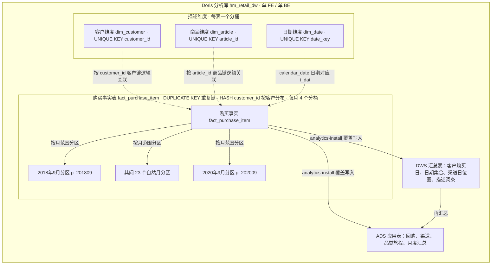

# 物理设计

- 状态：Doris 4.0.8 已建 DWD 明细表，以及可覆盖刷新的 DWS、ADS 汇总表
- 最后更新：2026-11-17（Asia/Shanghai）
- 文档职责：维护 Doris 数据库、字段类型、分区、键模型和分布设计

## 1. 数据库与执行边界

Doris 4.0.8 实例使用单 FE、单 BE。H&M 数据库为 `hm_retail_dw`，W09 的装载写操作均在此库执行。

明细建表脚本已在目标实例通过。实机核对了四张 DWD 业务表和 `p_201809` 至 `p_202009` 共 25 个正式分区。DWS 与 ADS 由 [分析层脚本](../sql/hm_recommendations/002_analytics.sql) 建表，并用 `INSERT OVERWRITE` 覆盖刷新。装载结果见 [数据处理设计](07-数据处理设计.md)。[H&M Doris 建表脚本](../sql/hm_recommendations/001_schema.sql)

## 2. 表清单

| 表 | 角色与粒度 | 键模型 | 分区／分布 |
| --- | --- | --- | --- |
| `fact_purchase_item` | 每行一件商品购买记录 | `DUPLICATE KEY(t_dat, customer_id, article_id)`；排序键可重复，不做唯一性约束 | `t_dat` 按月范围分区；按 `customer_id` 哈希，初始每分区 4 个 bucket |
| `dim_customer` | 每个源客户键一行静态属性快照 | `UNIQUE KEY(customer_id)`；加载前仍必须通过源键唯一性校验 | 不分区；单 bucket |
| `dim_article` | 每个源商品款式键一行商品目录 | `UNIQUE KEY(article_id)`；加载前仍必须通过源键唯一性校验 | 不分区；单 bucket |
| `dim_date` | 每个自然日期一行 | `UNIQUE KEY(date_key)` | 不分区；单 bucket |

`sales_channel_id` 作为购买事实中的编码维度，项目规定 1=线下、2=线上；不另造渠道名称表。`postal_code` 不进入首版分析维度。当前 Doris `dim_customer` 仍保留 nullable 的 `fn_source_flag` 和 `active_source_flag` 源字段列；其中 `FN` 不进入业务分析，空值保留为 NULL。

`dim_article` 已包含 `product_code`、具体 `article_id`、颜色、主色、明暗值和图案字段，足以支持款式族候选汇总及变体下钻。客户购买日序列存在 `dws_customer_purchase_day` 与 `dws_customer_purchase_sequence`，不再于每次查询时从明细聚合。

商品描述词条存在 `dws_article_description_term`。Streamlit 发起带筛选的查询时，在 Doris 内按变体汇总购买件数，再关联这张词条表输出排行。计算口径见 [W04 词条排行](02-需求分析.md#9-商品描述词条购买件数排行)。

### 2.1 DWS 与 ADS

两层都使用 `DUPLICATE KEY`，`replication_num=1`，不按月分区。客户粒度的 DWS 表按 `customer_id` 哈希，4 个 bucket；词条表按 `article_id` 哈希，4 个 bucket；ADS 结果行数少，各 1 个 bucket。字段注释和类型见分析层脚本。

| 表 | 粒度 | 排序键 |
| --- | --- | --- |
| `dws_customer_purchase_day` | 一位客户一个购买日 | `customer_id, t_dat` |
| `dws_customer_purchase_sequence` | 同一粒度，并带购买日序号及前后日期 | `customer_id, t_dat` |
| `dws_customer_purchase_dates` | 一位购买客户一行，日期为 `ARRAY<DATE>` | `customer_id` |
| `dws_customer_channel_dates` | 一位购买客户一行，两个渠道日 `BITMAP` | `customer_id` |
| `dws_article_description_term` | 一个商品编号加一个描述词条 | `article_id` |
| `ads_repurchase_stage` | 第 1 至 3 个购买日 × 30／60／90 日 | `purchase_day_no, horizon_days` |
| `ads_first_month_repurchase` | 首现月份 × 30／60／90 日 | `first_month, horizon_days` |
| `ads_customer_frequency_recency` | 近期性分段 × 购买日频次分段 | `recency_band, frequency_band` |
| `ads_channel_overlap` | 渠道组 `1`、`2`、`1+2` | `channel_group` |
| `ads_channel_switch` | 相邻单编码渠道对 | `from_channel, to_channel` |
| `ads_channel_day_profile` | 单编码日与混合编码日 | `channel_group` |
| `ads_category_journey` | 相邻购买日的商品组对 | `from_group, to_group` |
| `ads_monthly_overview` | 一个购买月 | `purchase_month` |
| `ads_monthly_product_group` | 购买月 × 渠道 × 商品组 | `purchase_month, sales_channel_id, product_group` |
| `ads_monthly_colour_group` | 购买月 × 渠道 × 颜色组 | `purchase_month, sales_channel_id, colour_group` |
| `ads_monthly_channel` | 购买月 × 渠道 | `purchase_month, sales_channel_id` |

`v_purchase_detail` 和 `v_display_labels` 仍是视图。其余 `v_` 名称是对应 DWS 或 ADS 表的读取视图，`SELECT` 不再包含聚合。Metabase 只读授权仍落在这些 `v_` 名称上，不授权客户粒度的 DWS 表。授权脚本见 [003_metabase_reader_grants.sql](../sql/hm_recommendations/003_metabase_reader_grants.sql)。

## 3. 物理表与分区布局图

- 事实表共 25 个正式自然月分区，每分区 4 个 bucket，合计约 100 个 tablet；图中折叠显示中间 23 个分区。
- 三张维度表各 1 个 bucket。所有表当前 `replication_num=1`，对应单 BE 开发环境。
- 装载期间创建的暂存维度表和临时分区不属于长期正式存储；校验后替换对应正式表或月份分区。
- 图中的虚线表示查询关联，不表示 DDL 声明了外键约束。DWS 和 ADS 是正式表，不是临时对象；事实重载后要重新运行 `analytics-install`，否则汇总表仍是上一版。

## 4. 字段类型依据

- `customer_id` 在源文件中最长 64 字符，使用 `VARCHAR(64)`；`article_id` 最大值为 959,461,001，使用有符号 `INT`。
- 商品分类编码使用足够容纳盘点范围的 `SMALLINT` 或 `INT`；商品名称与分类文本预留 `VARCHAR(32–96)`；`detail_desc` 实测最长 764 字符、766 个 UTF-8 字节，预留 `VARCHAR(1024)`。
- 交易日期使用 `DATE`，渠道编码使用 `TINYINT`；源 `price` 使用 `DOUBLE` 保存可计算的源数值，但查询只允许均值／中位数等描述性比较，不求和为营收。
- 客户年龄使用 nullable `SMALLINT`。源属性空值保持 `NULL`；未知不会被替换为零或否。
- `dim_date` 只包含标准日历字段，并同时保存 ISO 周所属年份和周序号；不加入未知地域的节假日或季节标签。

## 5. 分区、排序与分布

- 交易日期现有范围覆盖 2018-09-20 至 2020-09-22。按 2018-09-01 起、至 2020-10-01 止建立 25 个自然月分区；首尾分区覆盖不完整月份，分析时由指标层处理。
- 以 `(t_dat, customer_id, article_id)` 排序，兼顾时间切片、客户购买日查询和商品关联。Doris `DUPLICATE KEY` 允许排序键重复，能保留来源中完全相同的购买记录。
- 事实表按客户键哈希分布，每月先设 4 个 bucket；25 个月共约 100 个 tablet，适配当前单 BE 的初始规模。需要用实际导入后 tablet 大小与查询耗时复核，不宣称已完成性能调优。
- 所有表 `replication_num=1` 是当前单 BE 开发环境设置，不作为生产高可用配置。
- 小型维度各用 1 个 bucket，避免对当前单 BE 环境制造不必要的 tablet 数量。

## 6. 重载与查询策略

- 事实表保留全部原始购买行。装载器把交易按月写入 Doris 临时分区，经核对后一次替换选定月份的正式分区。维度通过同结构暂存表校验后按表替换。
- 客户、商品和日历维度使用唯一自然键；即便 Doris Unique Key 可覆盖已有键，装载器仍须先检查源键重复并拒绝异常，避免静默丢失冲突证据。
- 固定口径的回购、渠道、品类旅程和月度结果写入 ADS。带日期、渠道或商品类型筛选的商品查询仍读 `v_purchase_detail`，因为筛选组合会变，不适合收成一张结果表。
- Doris 与 Streamlit 统一使用[需求分析口径](02-需求分析.md)。下一阶段的 Metabase 正式接入沿用该口径。

## 7. 官方设计依据与验证范围

Doris 官方文档说明 Duplicate Key 模型保留所有写入行，即使行内容相同；Duplicate Key 的 key 列用于排序而不强制唯一。建表范围分区与表模型细节参照官方 [Duplicate Key 模型](https://doris.apache.org/docs/4.x/table-design/data-model/duplicate/)、[建表语法](https://doris.apache.org/docs/4.x/sql-manual/sql-statements/table-and-view/table/CREATE-TABLE/) 与[数据模型概览](https://doris.apache.org/docs/4.x/table-design/data-model/intro/)。

实机已通过建表 SQL、25 个分区创建、维度装载与全量事实接入。性能验收、其他平台复现及后续优化记录见 [测试与验收](09-测试与验收.md)。
